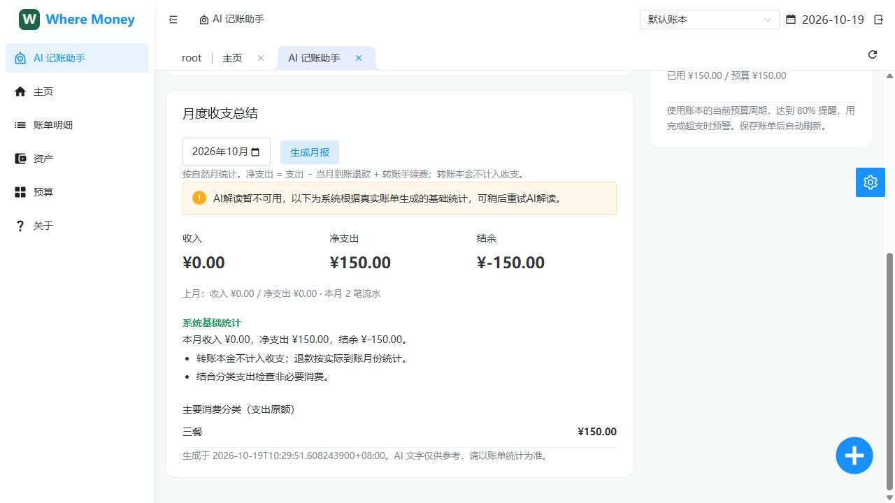
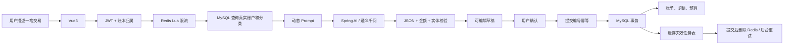

# Where Money · AI 个人记账

Java 21 / Spring Boot 3.5 / MyBatis / MySQL / Redis / Spring AI / Vue 3。

一个以后端账务正确性为重点的个人记账项目：自然语言生成可编辑草稿，用户确认后入账；SQL 计算收支和预算，大模型提供语义抽取与文字解读。



## 功能与模块

| 模块 | 能力 |
| --- | --- |
| 用户与权限 | 注册、登录、BCrypt 密码、JWT、请求结束清理用户上下文、资源归属校验 |
| 账本与分类 | 多账本、收入/支出分类、自定义分类、自定义每月预算起始日 |
| 账单 | 支出、收入、转账、关联退款、附件、修改与删除、余额联动 |
| 账户 | 资金/信用卡等账户类型、余额、资产统计与历史趋势 |
| 预算 | 总预算、分类预算、80%提醒、用完及超支提醒 |
| AI 记账 | 中文自然语言解析、真实候选集约束、实体校验、可编辑草稿、确认提交幂等 |
| 月报 | 当前及上月统计、前五消费分类、AI 解读、显式基础统计降级、数据指纹缓存 |
| 工程保障 | Redis Lua 限流、模型并发隔离和超时、审计脱敏、缓存失效重试、健康检查、OpenAPI |

**没有使用 MQ、向量数据库或 Agent 工具规划。** 动态账户与分类 Prompt 不等于完整 RAG。参见 [RAG 与 Agent 深挖](docs/RAG-AGENT.md)。

## 主要链路



## 本地运行（本机已安装 MySQL、Redis）

使用 PowerShell 7、Java 21、Node.js 20+。Windows 本地脚本默认使用现有 MySQL、Redis 安装路径，可通过参数覆盖。

```powershell
pwsh -File scripts/start-local.ps1 -Build `
  -JavaHome 'C:\path\to\jdk-21' `
  -MysqlBin 'E:\mysql-8.0.31-winx64\bin' `
  -RedisServer 'E:\Redis-x64-3.2.100\redis-server.exe'
```

- 页面：[http://localhost:13140](http://localhost:13140)
- 健康：[http://localhost:5050/actuator/health](http://localhost:5050/actuator/health)
- API 文档：[http://localhost:5050/swagger-ui/index.html](http://localhost:5050/swagger-ui/index.html)
- 本地数据库端口3307、库名`where_money_ai_local`，Redis端口6380、DB1。
- `.runtime/mysql`是独立测试数据目录，不使用原数据库。初始化时的空密码 root 仅用于127.0.0.1本地开发，不是部署配置。
- `pwsh -File scripts/stop-local.ps1` 只停止启动脚本记录且核验过的进程。脚本复用已有端口服务时，不接管它的生命周期。

## 模型配置

真实 AI 需要自己的有效模型服务密钥。可在启动后端的终端中设置：

```powershell
$env:SPRING_AI_OPENAI_API_KEY='your-key'
$env:SPRING_AI_OPENAI_BASE_URL='https://dashscope.aliyuncs.com/compatible-mode'
$env:SPRING_AI_OPENAI_CHAT_OPTIONS_MODEL='qwen3.5-plus'
```

也可把本地私有配置放在`.runtime/local-secrets.properties`，该目录不会提交。默认非local配置支持`AI_API_KEY`、`MYSQL_URL`、`MYSQL_USER`、`MYSQL_PASSWORD`、`JWT_SECRET`环境变量。JWT密钥至少32字符。

未配置或模型服务不可用时，手动记账继续可用，月报明确显示系统基础统计；不会生成假 AI 结果。

## 容器化运行

Docker 配置作为可移植交付方式；本机实际验收使用原生 MySQL、Redis，容器配置需在 Docker Engine 可用时验证。

```bash
cp .env.example .env
# 编辑 .env：数据库密码、至少32字符JWT密钥、可选模型密钥
docker compose up --build -d
```

MySQL/Redis不映射外部端口；应用入口仅绑定127.0.0.1。公网部署还需配置HTTPS、备份、监控告警、服务账号与密钥管理。

## 测试

```powershell
cd Where-Money-Backend
./mvnw.cmd test                       # 不依赖外部服务的单测
./mvnw.cmd -Dintegration=true verify   # 真MySQL/Redis，仅模型网关使用Mock
cd ../Where-Money-Frontend
npm ci --ignore-scripts
npm run typecheck
npm run build
cd ..
pwsh -File scripts/smoke.ps1           # HTTP核心流程，生成独立演示账号
pwsh -File scripts/smoke.ps1 -LiveAi   # 另验证真实模型及月报，服务需有额度
```

集成测试默认使用独立库`where_money_ai_test`和Redis DB2，可用`TEST_MYSQL_URL`、`TEST_MYSQL_USER`、`TEST_MYSQL_PASSWORD`、`TEST_REDIS_HOST`、`TEST_REDIS_PORT`覆盖。

旧项目的JUnit4演示用例依赖硬编码数据，不作为当前自动验收依据；新的JUnit5测试在`ai`和`service/ai`目录。CI显式运行集成测试。

## 阅读顺序

1. [架构、数据模型、缓存与事务](docs/ARCHITECTURE.md)
2. [接口与本地验收](docs/VERIFICATION.md)
3. [口语化 STAR 与后端八股追问](docs/INTERVIEW.md)
4. [RAG、Agent、大模型深挖](docs/RAG-AGENT.md)

## 项目边界与来源

这是可用于展示工程能力的个人账务项目，不是银行支付系统，不执行真实资金转账。金额、并发、鉴权和异常路径仍需要持续测试，不能声称“零缺陷”或未经测试的高并发指标。

基于原有 Where Money 记账系统扩展，前端原仓库为 [Shu-Huai/Where-Money-Frontend](https://github.com/Shu-Huai/Where-Money-Frontend)，布局依赖 Soybean Admin。保留来源说明，不把已有基础功能包装成全部原创。发布前应确认原始源码与依赖的许可要求。
