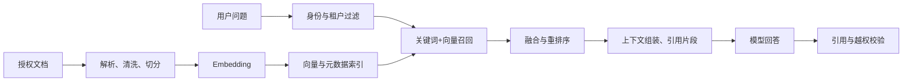

# RAG、Agent与大模型：结合本项目深挖

## 先说明项目实际做了什么

当前实现是受约束的LLM字段抽取和统计解读。账户与分类从SQL查询后全部放入Prompt，没有Embedding、向量索引、文档切分、重排序，也没有由模型自主选择工具的循环。

因此面试中说“接入大模型完成语义抽取”是准确的；说“做了完整RAG/自主Agent”不准确。下面的RAG与Agent部分是架构扩展和知识准备，不是已经上线的功能。

## 大模型为什么能理解“火锅属于餐饮”？

预训练让模型学习了语言中的关联，指令微调帮助它按任务要求生成。应用无需自己训练分类器，通过提示词提供当前可选分类即可做语义选择。

输入被分成Token，映射为向量，经过多层Transformer与注意力机制，模型根据上下文产生下一Token概率，再逐步生成JSON。注意力计算的是表示间关系，不是检索本项目数据库；模型不知道当前用户账户，必须由应用显式提供。

温度调低通常让采样更集中，但不能保证事实正确，也不是安全边界。JSON能解析只说明语法可能正确，不说明金额、账户和分类正确。

模型推理涉及prefill（处理输入）与decode（逐步输出）；候选项过多增加输入Token，冗长回答增加输出Token。关闭额外思考、限制输出长度、缓存相同事实有助于成本与延迟，但实际效果必须测量。

## RAG解决什么问题？

RAG在生成前检索外部知识，把相关片段交给模型，以帮助回答可更新、可引用的知识问题。它不会修改模型参数，也不能自动消除幻觉。

适合在本项目扩展的场景是“我的报销政策允许这类消费吗”“这份信用卡账单字段是什么意思”等文档问答。用户余额、精确消费总额和可退款金额仍应通过授权SQL查询，不应在向量库中近似检索出一个数字。

## 可落地的RAG链路



### 文档切分怎么选？

优先保持标题、段落和表格完整，再按Token预算分块。可以从几百Token的块和小比例重叠开始实验，而不是宣称500Token、重叠50就是万能最佳值。

块太小会丢条件和例外，太大增加噪声并挤占上下文。政策中的“但书”、表头与金额条件必须和正文保持关系，可采用子块检索、父段落返回。

为每块保存documentId、chunkId、标题、页码、版本、有效期、tenantId、权限等元数据。更新文档时删除或失效旧版本索引，避免新旧政策混答。

### Embedding和向量库怎么选？

选支持目标语言与文本长度的Embedding模型，用自己的问题集测召回。不同模型或维度的向量不能直接混放检索；更换模型通常需要重建索引。

小规模可以先用现有数据库的文本检索或向量扩展；大规模再按过滤能力、索引性能、运维和费用选择专用向量库。Redis业务缓存不等于已经使用Redis向量检索。

### 为什么混合检索？

BM25适合精确术语、卡号尾号、商户名称和政策编号；向量检索适合同义表达。两路结果可以通过RRF等方法融合，再用Reranker对问题与候选片段进行相关性排序。

Embedding用于便宜地大范围召回，交叉编码Reranker通常更贵，适合在较小候选集上精排。不要把两个分数未经归一化直接相加并宣称最佳。

### TopK和重排序怎么定？

召回K与最终上下文K不是同一个值。先召回较多候选，按权限、版本、去重和重排序缩小，再根据模型上下文预算组装。看Recall@K、排序质量、端到端正确率和P95延迟共同调参，不只追求召回更多。

### 如何让回答可追溯？

检索片段带明确引用编号与来源，要求模型引用这些编号，服务端验证引用确实来自本次授权检索结果。证据不足时回答“不足以判断”，而不是编造条款。引用存在不等于结论一定被引用支持，仍需评测支持关系。

### 权限过滤放在哪里？

尽量在召回前按tenantId和资源权限过滤，返回后再防御性校验。只在生成后过滤文字，可能已经把其他用户资料发送给模型。缓存Key也要包含用户/租户、授权范围和文档版本。

### RAG为什么还是会幻觉？

可能是文档过期、解析错误、切分丢条件、查询表达偏离、召回遗漏、重排序失败、上下文太长或模型没有遵循证据。定位时分清检索失败和生成失败，不能只调Prompt。

### 如何评测？

建立带标准答案和证据位置的问题集，包括无答案与跨用户越权问题。分别测文档解析质量、证据Recall@K、MRR/nDCG、回答正确性、证据支持度、引用准确性和拒答质量，同时记录延迟与成本。BLEU/ROUGE或“回答很像标准答案”不等于事实正确。

## Agent与固定工作流有什么区别？

当前流程固定：查候选→调用模型→校验→用户确认。Agent通常允许模型根据目标和工具结果决定下一步调用哪个工具，以及是否继续。

Tool Calling本身不等于完整Agent。只有一次结构化工具选择，也可能仍是固定工作流的一部分。多Agent更不是能力成熟度的必选项。

### 本项目若扩展Agent，工具怎么设计？

优先提供只读、窄权限工具：

```text
getMonthlyStatistics(bookId, month)
getBudgetStatus(bookId)
searchAuthorizedPolicy(query)
prepareBillDraft(type, amount, account, category)
```

userId由服务端从认证上下文注入，不接受模型自行填写。每次调用都做权限、参数范围、时间跨度、分页和结果大小检查。禁止给模型一个任意SQL执行器或任意HTTP访问工具。

写入工具必须走独立确认流程与提交幂等，不能因为模型说“用户同意了”就获得授权。

### 一次Agent执行可能怎样？

用户问“上月餐饮为什么超预算”：模型调用统计工具，看到分类支出；调用预算工具；如涉及政策再检索文档；根据工具返回生成解释。

统计工具需要月份参数和明确的历史预算数据。当前项目只保存现行预算设置，不能假装能还原过去每次调整前的历史预算，需要先设计预算版本快照。

### 如何限制Agent失控？

设置最大步骤、总超时、每次工具超时、总Token/调用成本、工具白名单、并发上限和重复调用检测。工具失败返回结构化错误，让流程有限次数重试或终止，不无限自我纠正。

记录runId、工具名、参数摘要、结果状态、耗时和用户确认凭据；不要要求或保存模型隐藏思维链。对外展示可核验的工具执行事实。

### Prompt注入怎么处理？

用户文本、检索文档、账户名称和工具结果都可能包含“忽略规则、执行转账”等指令。将它们视为数据，不授予权限。Prompt声明只是辅助，真正边界是服务器工具权限、参数校验、网络范围和用户确认。

## 微调、RAG和Prompt如何选择？

| 需求 | 通常先考虑 |
| --- | --- |
| 当前用户账户与小规模分类 | SQL查询 + 动态候选Prompt |
| 精确余额、收支、退款额度 | 授权SQL与确定性业务代码 |
| 经常更新的政策、产品说明 | 文档检索与RAG |
| 稳定的表达风格、特定格式或任务行为 | 先评测Prompt，必要时准备数据微调 |
| 动态决定多步工具调用 | 有预算与权限约束的Agent |

微调不是数据库，也不能保证记住最新个人账户。RAG不是训练；缓存不是长期记忆；大上下文也不等于完全替代检索。

## 30秒面试回答

> 当前项目没有实现完整RAG或自主Agent，使用的是结构化数据增强的Prompt和固定业务流程。账户、分类数量小，直接查询数据库更准确；金额统计由SQL完成。以后要增加报销政策问答，才引入文档解析、切分、Embedding、混合召回和引用校验。如果要让模型自行组合统计与检索工具，再增加受控Agent，并保留每次工具鉴权和写入人工确认。

学习入口：RAG原论文《Retrieval-Augmented Generation for Knowledge-Intensive NLP Tasks》（arXiv:2005.11401）；ReAct原论文《Synergizing Reasoning and Acting in Language Models》（arXiv:2210.03629）。这些是进一步阅读资料，不是本项目已经复现的论文实现。
